# Wolfish Revenge — этапы игры

Рабочий документ с краткими описаниями локаций кампании и визуальными кадрами. Обновляется по мере согласования этапов.

## Схема кампании

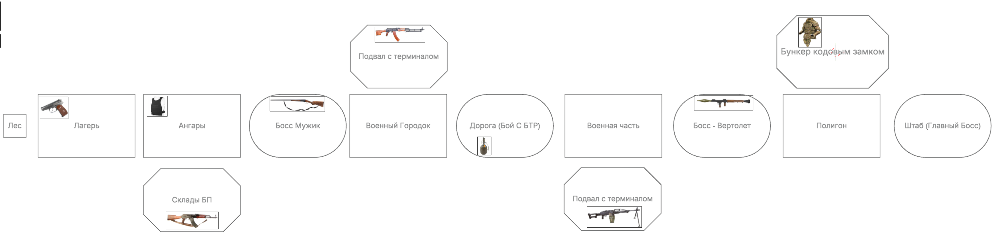

## 1. Лес

**Статус:** обязательная стартовая локация.

**Назначение:** ввод в сюжет и первое знакомство с превращением в оборотня.

**Игровая задача:** освоить превращение в волка и пробежать через лес до лагеря.

### Завязка

Игрок начинает в тёмном лесу рядом со своей палаткой и потухшим костром. Военные увозят его девушку, а героя оглушают. Очнувшись, он от первого лица видит окруживших его волков. Затем, выйдя в лунный свет, герой впервые превращается в оборотня.

### Кадры катсцены

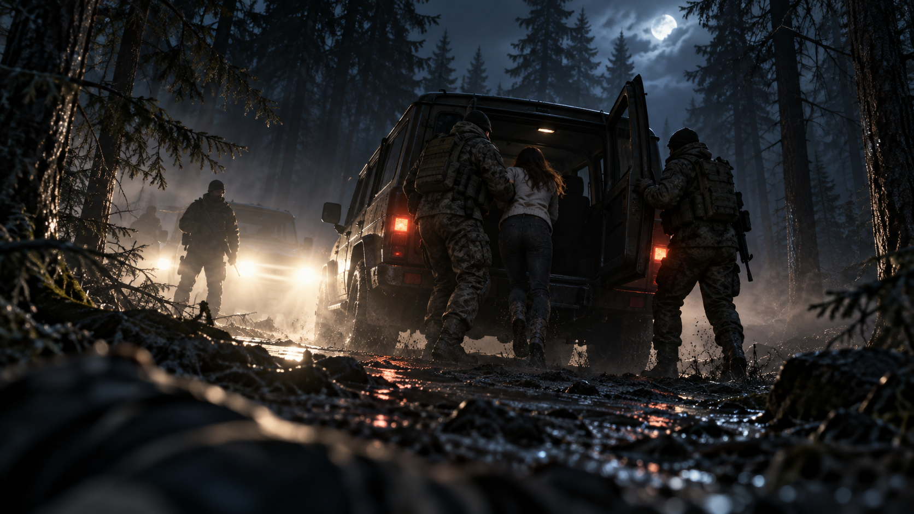

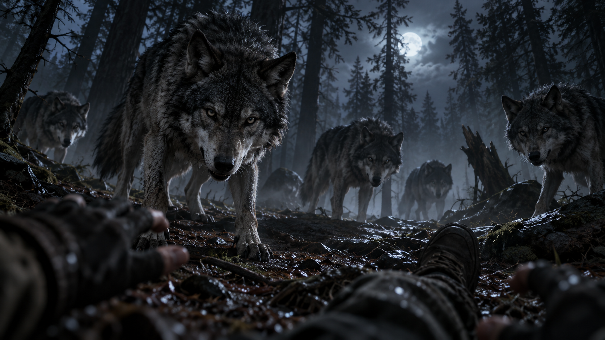

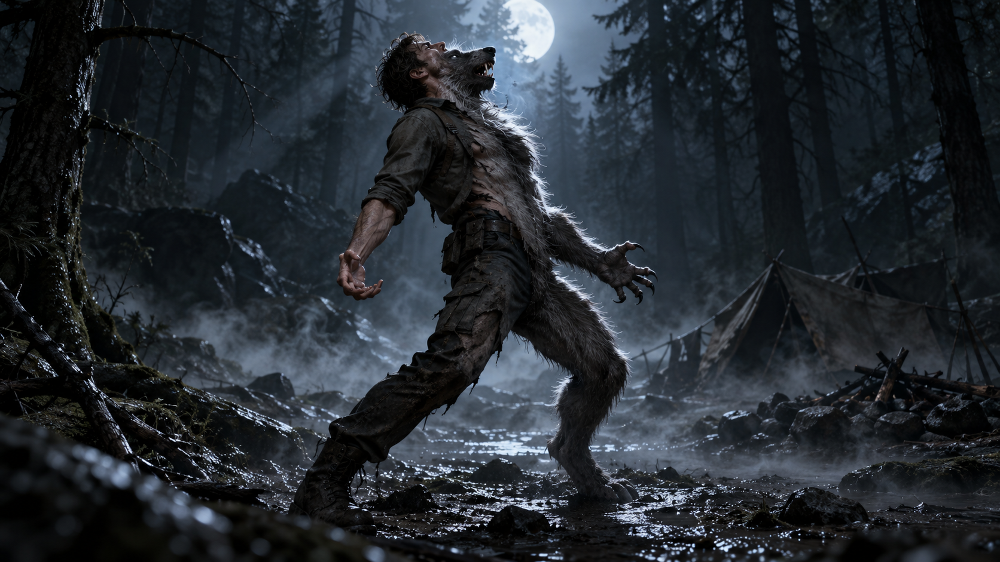

## 2. Лагерь

**Статус:** обязательная локация.

**Назначение:** первое боевое проникновение на военный объект.

**Игровая задача:** пройти через лагерь, используя скрытность или открытый бой; после первого устранения врага получить пистолет.

### Описание

Ночной военный палаточный лагерь в лесу. С этого этапа начинается дождь. На территории расположены около десяти крупных армейских палаток, складские ящики, песчаные мешки и две вышки с прожекторами.

### Прохождение

Локацию можно пройти скрытно: использовать тень, шум дождя, палатки и складские ящики как укрытия, а также бесшумно устранять одиночных патрульных. Открытый бой остаётся допустимым вариантом.

### Награда и темп

После первого убийства игрок получает пистолет и может применять его до конца этапа. Лагерь короткий и почти обучающий: он знакомит с выбором между стелсом, ближней атакой и огнестрельным боем.

### Кадры катсцены

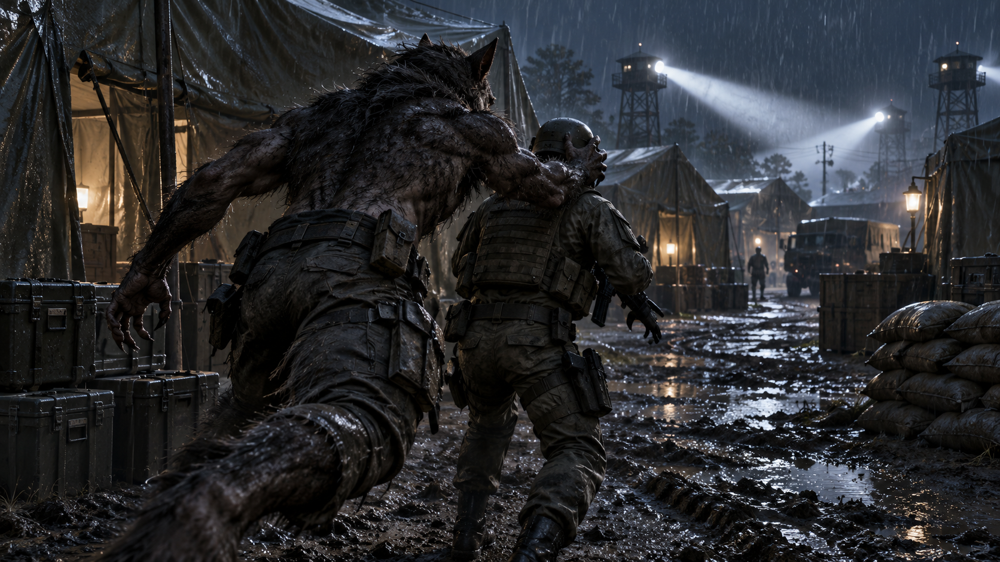

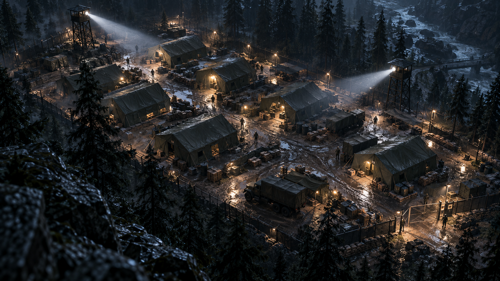

## 3. Ангары

**Статус:** обязательная локация.

**Назначение:** более серьёзный военный объект и подготовка к первому боссу.

**Игровая задача:** пройти военные ангары, найти первый бронежилет и подготовиться к бою с боссом.

### Описание

Военные ангары — более крупный и укреплённый объект, чем палаточный лагерь. В локации есть серьёзные сооружения, вышки и инфраструктура базы. Здесь игрок находит первый бронежилет.

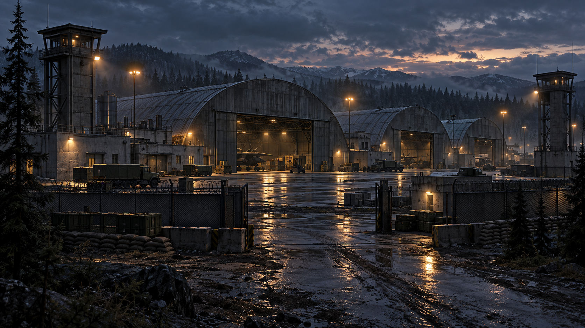

### Отдельный складской ангар

В зоне ангаров расположен отдельный складской ангар, где игрок может найти автомат Калашникова.

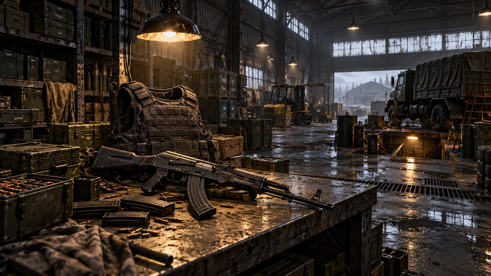

### Переход к боссу

В финале локации начинается плавный переход к босс-файту. Перед ним игрока быстро знакомят с механикой вырывания дверей автомобиля: дверь используется как переносное укрытие, позволяющее подбираться к противнику с дробовиком.

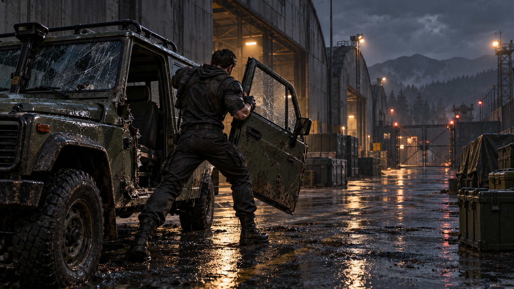

## 4. Босс Михалыч

**Статус:** обязательный босс-файт.

**Босс:** Михалыч — крупный мужчина в тельняшке и ватнике, вооружённый двустволкой.

**Игровая задача:** сблизиться с боссом под огнём и победить его стрельбой или наброском.

### Появление босса

Игрок выходит на открытую площадку. Из военного жилого прицепа на колёсах с ноги вылетает Михалыч: он держит двустволку наготове, отпивает водку и замечает героя. Появление подаётся короткой катсценой в нарочито клишированном полукомиксном стиле.

### Арена и бой

Арена в основном открытая. Между игроком и боссом размещены автомобили, ящики, барьеры и другие препятствия, которые позволяют постепенно сокращать дистанцию перебежками. Несколько машин можно перевернуть и использовать как укрытия. Ранее освоенная автомобильная дверь также помогает двигаться под огнём двустволки.

### Условие победы

Игроку нужно добраться до Михалыча, не получив слишком много выстрелов. После сближения босса можно застрелить или атаковать наброском.

### Кадры катсцены

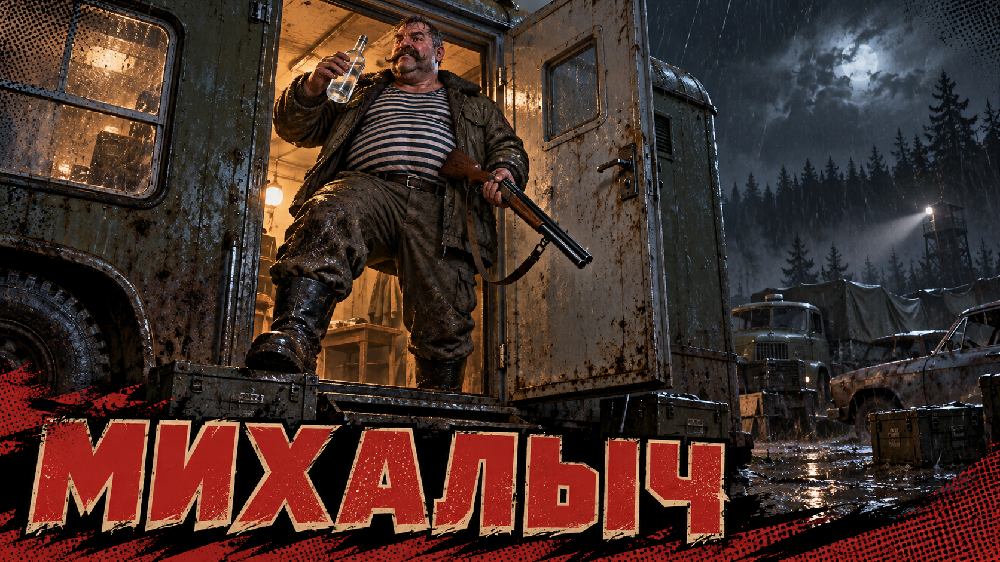

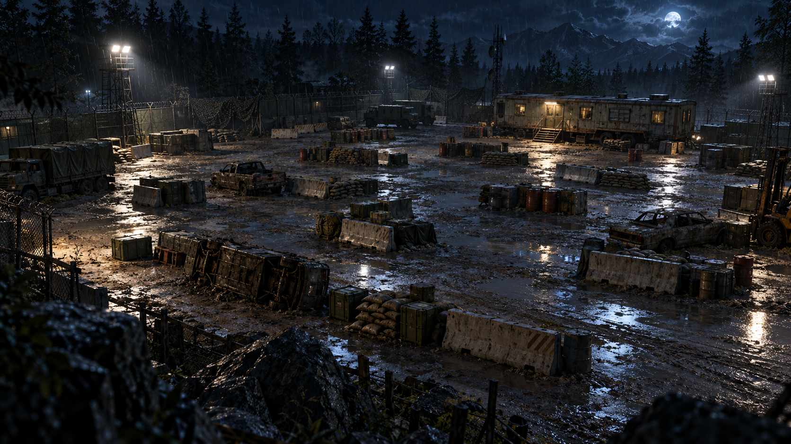

## 5. Военный городок

**Статус:** обязательная локация.

**Назначение:** освоение вертикального перемещения, прыжков в окна и прохождения через здания.

**Игровая задача:** преодолеть низкую застройку, выбирая путь по крышам, через окна или по земле.

### Описание

Классический невысокий военный городок с двух- и трёхэтажными домами, дворами и узкими проходами между зданиями. Локация строится вокруг свободного выбора маршрута: игрок может идти по земле, забираться на крыши или проходить дома насквозь. Это зона с элементами попрыгушек: крыши, окна и дворы складываются в несколько взаимосвязанных путей.

### Новая механика

На этапе игрок знакомится с прыжками в окна. Волк может с разбега влетать в оконный проём, быстро менять маршрут, врываться внутрь здания и продолжать движение через комнаты к противоположному выходу.

### Бой и маршруты

Часть противников патрулирует крыши, часть остаётся на земле. Игрок сам выбирает высоту и путь: сражаться на улицах, обходить врагов по крышам или использовать здания для укрытия и флангового прохода. Ни один из этих маршрутов не считается единственно правильным: игрок может менять его на ходу, прыгая в окна и между доступными крышами.

## 6. Дорога — бой с БТР

**Статус:** обязательный бой с техникой.

**Угроза:** БТР разрушает почти все стационарные укрытия.

**Игровая задача:** уклоняться от огня, быстро менять позицию и уничтожить БТР гранатами.

### Описание

Дорога от военного городка выводит игрока на бой с БТР. Машина атакует издалека и методично разрушает почти все стационарные укрытия, поэтому нельзя переждать обстрел в одном месте.

### Тактика и механики

Игроку нужно постоянно бегать и менять укрытия. На дороге стоят ящики с гранатами: ими требуется закидывать БТР. Для коротких перебежек герой вырывает двери припаркованных машин и использует их как переносную защиту.

### Кадр появления

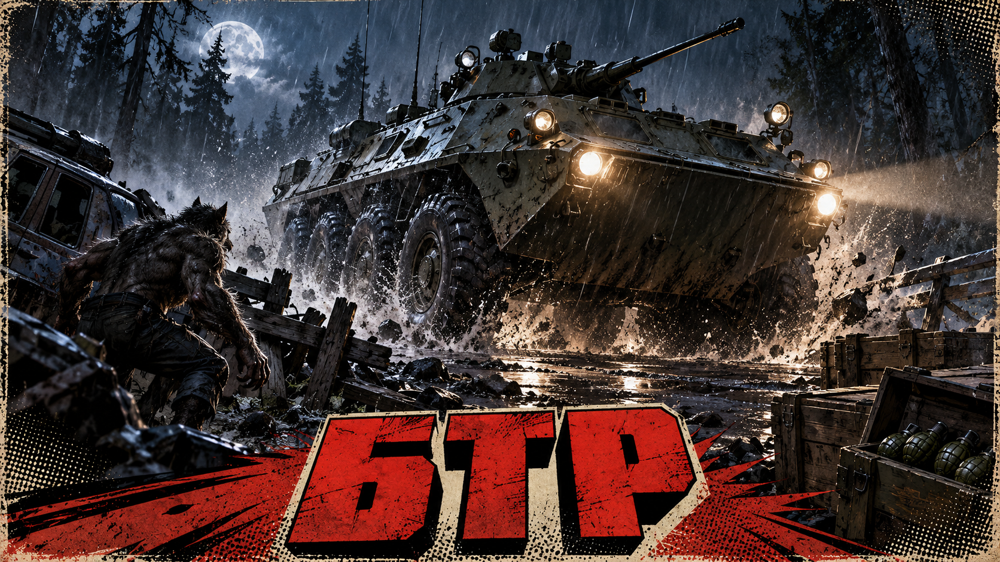

## 7. Военная часть

**Статус:** обязательная вертикальная стелс-секция.

**Цель:** проникнуть внутрь высокой военной части и выйти на крышу.

**Ограничение:** на фасад нельзя запрыгнуть, а все окна защищены решётками.

### Фасад и вход

Военная часть представляет собой высокое П-образное здание с главным входом на фасаде. Его высота исключает прыжок на крышу, а решётки на окнах закрывают привычный путь через оконные проёмы. Игроку нужно попасть внутрь через главный вход или другой наземный проход.

### Подъём на крышу

После проникновения начинается маршрут вверх: герой проходит через внутренние помещения, находит лестничный путь и поднимается на крышу. Крыша становится точкой выхода к следующему этапу.

### Интерьер и стелс

Внутри военной части коридоры разбиты бетонными стенками и перегородками. Игрок скрывается за ними, наблюдает за патрулями и продвигается от укрытия к укрытию. Открытый бой возможен, но планировка прежде всего поддерживает осторожное скрытное прохождение.

### Кадры сцены

## 8. Босс вертолёт

**Статус:** обязательный бой с техникой.

**Угроза:** вертолёт контролирует открытое пространство огнём сверху и не позволяет долго оставаться на одном месте.

**Игровая задача:** добраться до РПГ, выбрать момент для выстрела и уничтожить вертолёт.

### Появление

После выхода с крыши военной части игрок оказывается на открытом участке маршрута. Вертолёт перехватывает героя и начинает вести огонь сверху, вынуждая сразу искать укрытие и двигаться дальше по площадке.

### Арена и бой

Бой строится вокруг коротких перебежек между укрытиями. Вертолёт меняет позицию в воздухе и простреливает открытые участки, поэтому игроку нельзя надолго останавливаться. На арене находится РПГ: это обязательная находка для данной сцены, а не случайный предмет.

### Условие победы

Игроку нужно подобрать РПГ, дождаться удобного момента и поразить вертолёт. Победа открывает путь к полигону.

## 10. Штаб — финальная конфронтация

**Статус:** обязательный финальный этап после полигона.

**Босс:** бронированный генерал — похититель девушки героя.

**Игровая задача:** пройти через охрану на плацу, подняться к трибуне и вступить в финальную схватку с генералом, удерживающим заложницу.

### Общий план локации

Штаб — крупное постсоветское административное здание образца 1995 года: потемневший бетонный фасад, ряды прямоугольных окон и старые прожекторные мачты. Перед зданием расположен широкий плац с мокрым асфальтом и лужами; ночной ливень, луна, прожекторы и жёлтый свет из окон создают холодную мрачную атмосферу.

От плаца к главному входу идёт огромная бетонная лестница. Её широкая промежуточная площадка служит трибуной. На трибуне находится генерал из пролога в тяжёлой броне эпохи позднего СССР / 1990-х; рядом с ним — похищенная девушка, которую он удерживает в заложниках.

### Расстановка в начале боя

Главный герой — вооружённый оборотень в бронежилете и разгрузке 1990-х — начинает внизу, на плацу. Несколько бронированных бойцов в постсоветской экипировке перекрывают основание лестницы: старые шлемы, бронежилеты, разгрузки и автоматы семейства АК. Генерал и заложница остаются на высоте, на центральной трибуне.

Композиция первой сцены намеренно симметрична: оборотень на плацу, охрана у ступеней, генерал с заложницей на трибуне, штаб за ними. Она подчёркивает масштаб последней схватки и вертикальную дистанцию между героем и его целью.

### Кадр появления

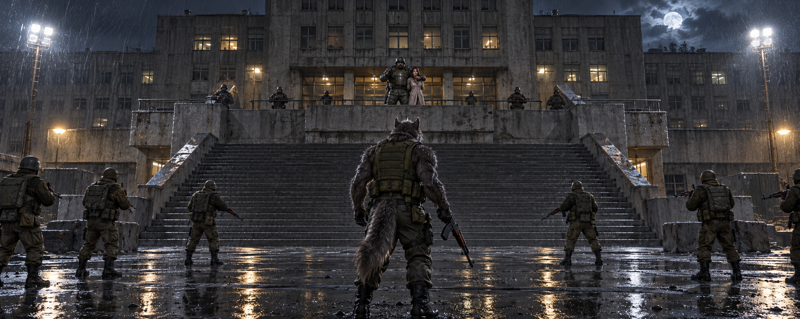
