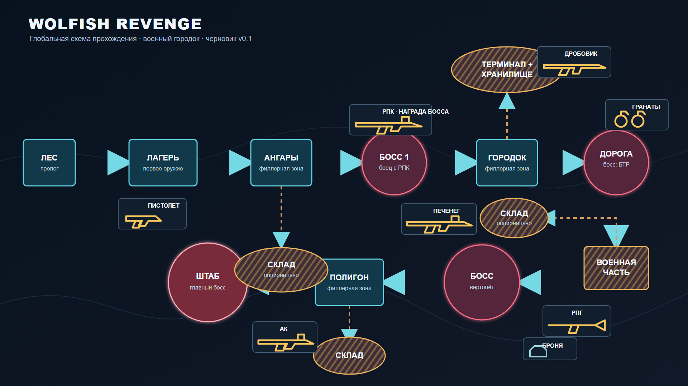
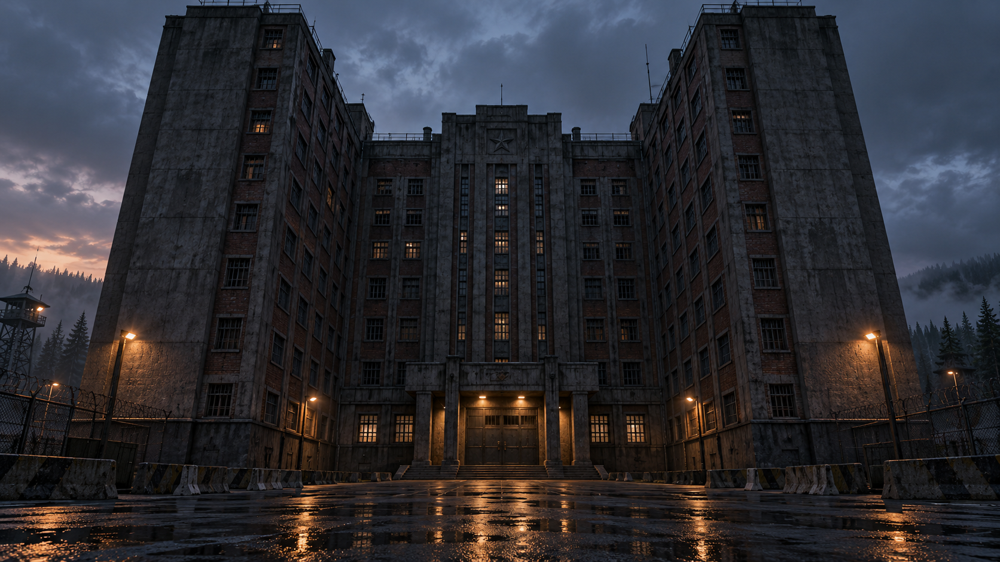
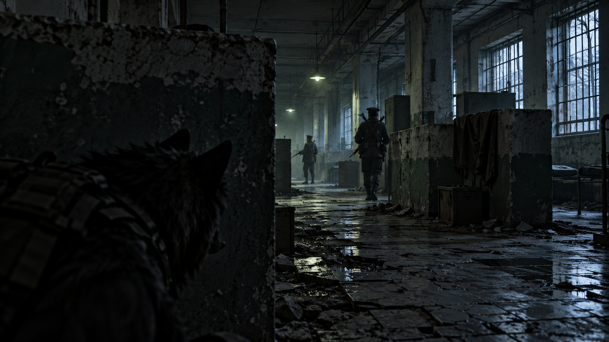

# Wolfish Revenge — глобальная раскадровка

> Черновик v0.1. Этот файл будет содержать карту прохождения, последовательность сцен, изображения и их описания. На текущем этапе добавлена только утверждённая схема маршрута.

## Зафиксированная структура маршрута

Лес → Лагерь → Ангары → Босс 1 (боец с РПК) → Городок → Дорога (босс БТР) → Военная часть → Босс-вертолёт → Полигон → Штаб (главный босс).

Опциональные ответвления: склад у ангаров (АК), терминал с хранилищем у городка (дробовик), склад у военной части (Печенег и броня), склад у полигона.

Заштрихованные зоны рассчитаны преимущественно на прохождение в человеческой форме. Прямоугольники — филлерные зоны, круги — ключевые точки либо точки интереса с дополнительным лутом.

## Военная часть

Высокое П-образное здание после боя с БТР. Игрок проникает внутрь через наземный вход: прыжок на фасад невозможен, а окна защищены решётками. Внутренние коридоры с бетонными перегородками формируют стелс-маршрут до лестницы и крыши.

